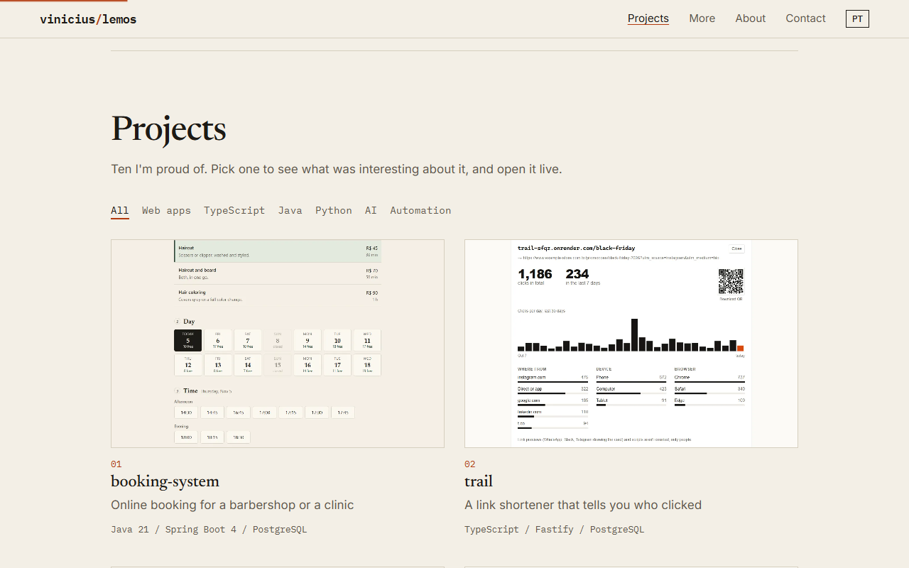

# viniciusclemos.github.io


My portfolio: the projects I'm proud of, a bit about me and how to reach me.

**Live:** [viniciusclemos.github.io](https://viniciusclemos.github.io/)


## How it's made

Plain HTML, CSS and JavaScript, no framework and no build step. The page is small and static, so a framework would mostly add weight. GitHub Pages serves the `site/` folder as it is.

The projects come from one list in [`site/projects.js`](site/projects.js), so adding one is a new entry there and nothing else.



### Projects you can click

Each card opens the project in a `<dialog>`: a bigger screenshot, what was interesting to build, the stack, and links to the live site and the code. The browser's dialog already closes on Esc, keeps the keyboard inside and gives the focus back to the card. The address changes to `#trail`, `#recon`..., so a link to one project opens it directly, and the back button closes it.


### The scroll effects

- Sections and cards slide up as they come into view. An `IntersectionObserver` adds a class the first time each one shows up, and cards in the same row come in one after the other.
- A thin line on top shows how far down the page you are, and the menu underlines the section on screen.
- The glow behind the top fades as you scroll away from it.

All of it reads the scroll in one listener, once per animation frame. With "reduce motion" turned on in the system, nothing moves and everything is simply there.

## Tests

```bash
npm install
npx playwright install chromium
npm run e2e
```

Playwright opens the page on a desktop and a phone screen: every project opens with its links (and closes with Esc or the back button), things appear as they scroll in, the menu follows the section, reduced motion shows everything, nothing is wider than the screen, and axe finds no accessibility problems in the dark or the light theme. The deploy only happens after these pass.

MIT license.
