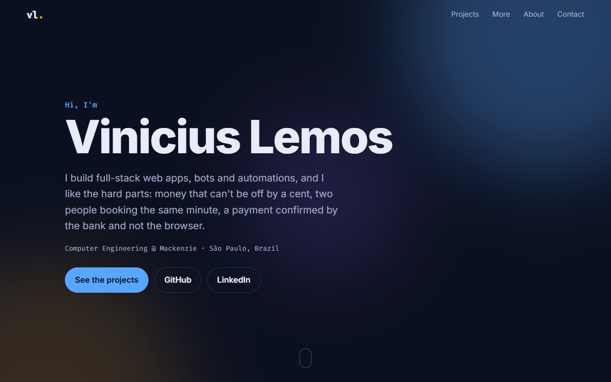
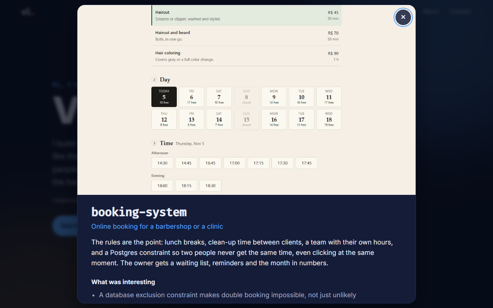

# viniciusclemos.github.io


My portfolio: the projects I'm proud of, a bit about me and how to reach me.

**Live:** [viniciusclemos.github.io](https://viniciusclemos.github.io/)



## How it's made

Plain HTML, CSS and JavaScript, no framework and no build step. The page is small and static, so a framework would mostly add weight. GitHub Pages serves the `site/` folder as it is.

The look is meant to be read more than looked at: cream paper, a serif for the titles, a monospace for the small print and one rust color. The cards are numbered and the stack is written out like a note (`Java 21 / Spring Boot 4 / PostgreSQL`), no badges or gradients.

The projects come from one list in [`site/projects.js`](site/projects.js), so adding one is a new entry there and nothing else.


### Projects you can click

Each card opens the project in a `<dialog>`: a bigger screenshot, what was interesting to build, the stack, and links to the live site and the code. The browser's dialog already closes on Esc, keeps the keyboard inside and gives the focus back to the card. The address changes to `#trail`, `#recon`..., so a link to one project opens it directly, and the back button closes it. "Copy the link" puts that address on the clipboard, with `?lang=pt` when the page is in Portuguese.



Above the cards, buttons filter them by what they're made with (Java, Python, TypeScript, AI...). The cards that stay slide into their new places instead of jumping: each one is measured before and after the change and animated from where it was (the FLIP technique).

### English and Portuguese

The button next to the menu switches the whole page, projects included, between English and Portuguese. A link with `?lang=pt` opens it in Portuguese (handy for sharing with Brazilian recruiters), and without it the page follows what the visitor picked before or the browser's language. The fixed text is marked with `data-i18n` and comes from [`site/i18n.js`](site/i18n.js); each project carries its Portuguese text next to the English one.

### The preview card

When the link is shared on LinkedIn or WhatsApp, the card shows [`site/og.png`](site/og.png), a picture of the top of the page. Those apps don't run JavaScript, so the `og:` tags are fixed in the HTML, in Portuguese, since that's where the link gets shared the most.

### The scroll effects

- Sections and cards slide up as they come into view. An `IntersectionObserver` adds a class the first time each one shows up, and cards in the same row come in one after the other.
- A thin line on top shows how far down the page you are, and the menu underlines the section on screen.
- A rule under the header shows up once the page leaves the top.

All of it reads the scroll in one listener, once per animation frame. With "reduce motion" turned on in the system, nothing moves and everything is simply there.

## Tests

```bash
npm install
npx playwright install chromium
npm run e2e
```

Playwright opens the page on a desktop and a phone screen: the filter shows the right projects, the switch to Portuguese works and is remembered, every project opens with its links (and closes with Esc or the back button), things appear as they scroll in, the menu follows the section, reduced motion shows everything, nothing is wider than the screen, and axe finds no accessibility problems in the dark or the light theme, in either language. The deploy only happens after these pass.

MIT license.
